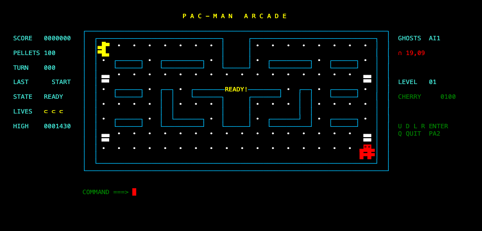

# Pac-Man for MVS 3.8J

A real-time Pac-Man written in COBOL with a few small assembler services. It runs entirely on an emulated mainframe
(MVS 3.8J on Hercules) and is played on a 3270 terminal (TSO).



> **You are on the `main` branch: the MVS 3.8J version (release 2.1-mvs).**
> The IBM z/OS port is in a separate branch:
> [**`zos` branch**](https://github.com/jmplaza75/pacman-mvs-zos/tree/zos).

## Which branch is which

| Branch | Platform | Release | Toolchain |
|---|---|---|---|
| **`main`** (this one) | MVS 3.8J (TK4-) on Hercules | 2.1-mvs | IBM OS COBOL (`IKFCBL00`), assembler |
| [`zos`](https://github.com/jmplaza75/pacman-mvs-zos/tree/zos) | IBM z/OS V3R1 | 2.1-zos | Enterprise COBOL 6.5, HLASM, LE |

The z/OS code is **not** in a folder of this branch. Switch to the `zos` branch (branch menu at the top left of the
file list) to see it. It has its own README with the z/OS instructions.

## What you get

- Arcade rules: power pellets, frightened ghosts, levels, fruit, extra lives.
- Real time: the game moves by itself every 150 ms.
- Colour 3270 screen with a scaled maze, partial redraw and animation.
- Terminal bell as sound, with a different pattern per event.
- Four ghost AI levels, deterministic and testable.
- A persistent high score kept in a dataset.
- The original 1.0 game (`RULES(CLASSIC)`) and a batch mode that plays from a card file.

## Requirements

- Hercules running the TK4- system. See [`docs/ENVIRONMENT.md`](docs/ENVIRONMENT.md).
- The card reader on `127.0.0.1:3505`.
- Python 3.
- A TSO user that can create `HERC01.PACMAN.*` datasets (the prefix is configurable).
- `c3270` as the terminal.

Keep the password in a local `.env` file (`HERC01_PASSWORD=...`). The file is git-ignored and never printed.

## Play

1. Make the terminal window 120 x 30, then start `c3270` with the game keymap:
   ```bash
   TYPEAHEAD=false tools/c3270_rt.sh
   ```
2. Log on to TSO.
3. At `READY`, start the game:
   ```
   EXEC 'HERC01.PACMAN.CLIST(PACMAN)'
   ```
   With no operand you get the arcade game in real time.

Pac-Man waits for your first move, then keeps going on his own.

### Controls

| Action | Key |
|---|---|
| Up / Down / Left | PF7 / PF8 / PF10 |
| Right | PF12 |
| Pause / resume | PF9 |
| Redraw the screen | PA2 |
| Quit | type `Q`, then ENTER |

`tools/c3270_rt.sh` maps the arrow keys to these PF keys. No PF key quits the game.

### Sound

The game rings the terminal bell. In macOS Terminal turn on
*Settings > Profiles > Advanced > Audible bell*.

### Options

Add options in quotes after the CLIST name:

```
EXEC 'HERC01.PACMAN.CLIST(PACMAN)' 'RULES(CLASSIC) PLAY(TURN)'
EXEC 'HERC01.PACMAN.CLIST(PACMAN)' 'SPEED(FAST) SOUND(NO)'
EXEC 'HERC01.PACMAN.CLIST(PACMAN)' 'COLOR(YES) HILITE(YES) GLYPHS(GRAPHIC)'
```

All options and their defaults are in [`releases/2.0-MVS-MAX/DEFAULTS.md`](releases/2.0-MVS-MAX/DEFAULTS.md).

## Play from a card file (batch)

```bash
python3 tools/make_deck.py RUN --cards my-game.txt && python3 tools/run_deck.py build/RUN.jcl
```

The card file has one command per line. An optional first line such as `AI3 2` picks the ghost AI level and the
number of ghosts. The game is printed in the job listing.

## Build and install

Create the empty libraries, then build and check the release:

```bash
python3 tools/make_deck.py ALLOC --prefix HLQ.NAME && python3 tools/run_deck.py build/ALLOC.jcl
./tools/release_check.sh 2.0 HLQ.NAME
```

The full procedure is in [`docs/mvs-build.md`](docs/mvs-build.md).

## Repository layout

| Path | Contents |
|---|---|
| `src/` | COBOL, assembler, copybooks and the CLIST |
| `jcl/mvs/` | MVS job decks |
| `tools/` | Deck generation, submit, check and terminal helpers |
| `tests/` | Python models and regression tests (no mainframe needed) |
| `docs/` | Design notes, decisions, evidence |
| `releases/` | Release notes, manifests, checksums |

## Tests

The game rules are checked against independent Python models with fixed seeds. Run one test at a time:

```bash
python3 tests/test_core_frozen.py
```

Some tests compare the code with release tags, so clone with the tags (`git clone` does this by default).

## More documentation

- [`docs/FULL-GUIDE.md`](docs/FULL-GUIDE.md): the complete original guide, with every phase and option.
- [`docs/ARCHITECTURE.md`](docs/ARCHITECTURE.md): how the program is layered.
- [`docs/DECISIONS.md`](docs/DECISIONS.md): rules and design decisions.
- [`releases/2.1-MVS/RELEASE-NOTES.md`](releases/2.1-MVS/RELEASE-NOTES.md): what changed in 2.1-mvs.

## License

MIT, see [LICENSE](LICENSE).
